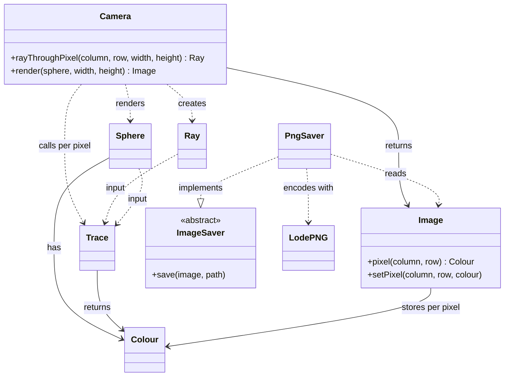

# Discovery report

## 1.Problem statement

A film studio in Los Angeles struggles with unreliable and difficult-to-maintain rendering software, making it hard to identify problems, add new features and consistently produce high-quality images without costly delays and external dependencies.

## 2.Client interview summary

The following is a summary of the client interview, organized by theme. The questions and answers have been reconstructed from my notes, so they may not reflect the exact words used during the discussion.

### Reliability and problem diagnosis

**Need:** The studio needs reliable rendering software that allows its team to identify and understand the causes of problems when they occur.

> **Q (Colleague):** "What happened with your previous rendering project?"
>
> **A:** "Our last project was stopped six months ago. We had black artifacts appearing in the rendered images, and the team couldn't understand what was causing them."

> **Q (Colleague):** "What is most important to you in terms of software reliability?"
>
> **A:** "Reliability is very important, but the most important thing is being able to find the problem and understand where it comes from."

**My conclusion:** The studio's main concern is not only preventing failures but also being able to investigate them. The new renderer should make problems easier to understand and diagnose, so the team does not face the same difficulties as in the previous project.

### Licensing costs and software limitations

**Need:** The studio needs more control over its rendering software and the freedom to improve it without being restricted by expensive licenses or external providers.

> **Q (Colleague):** "What problems did you face with your previous software licenses?"
>
> **A:** "The licenses were very expensive, and we didn't get the results we expected. We spent around two million dollars and lost that money."

> **Q (Colleague):** "How did these licenses affect your ability to add new features?"
>
> **A:** "We were limited by the licenses we had. Adding a new feature could take six months to a year."

**My conclusion:** The previous solution created both financial and technical difficulties. The studio wants to avoid depending on a vendor for every change and have more freedom to improve its software over time.

### Project deadline

**Need:** The studio needs the software to be delivered and ready for production by January 15.

> **Q (Colleague):** "When do you expect the software to be delivered?"
>
> **A:** "The software must be delivered by January 15, and it needs to be ready for production."

**My conclusion:** The deadline is an important constraint for the project. We need to understand what the client considers essential for the first production release and what can be developed later.

### Existing infrastructure

**Need:** The studio has an existing infrastructure of approximately 100 machines, but their role in the new rendering project still needs to be clarified.

> **Q (Colleague):** "What computing resources does your studio currently have?"
>
> **A:** "We have around 100 machines."

**My conclusion:** The studio already has computing resources available. However, I cannot assume that all these machines will participate in rendering. Their purpose, specifications and expected use still need to be discussed with the client.

### Artistic workflow and rendering iterations

**Need:** The rendering process must support the artists' workflow, where several iterations may be necessary to achieve the desired visual result.

> **Q (Me):** "Could you describe what you mean by ten pre-renders per image, and how this process fits into your production workflow?"
>
> **A:** "Sometimes we need to render an image up to ten times before getting the result we want artistically."

**My conclusion:** Multiple renders are part of the normal artistic process, not necessarily the result of technical problems. The time needed for these iterations could affect the artists' workflow, so it would be useful to understand how long they usually take.

### Image resolution and visual quality

**Need:** The studio needs to produce high-quality images in HD format, with visual quality being a major priority for the final result.

> **Q (Colleague):** "What image format do you use for your productions?"
>
> **A:** "We use HD format."

> **Q (Colleague):** "How important is image quality for the final result?"
>
> **A:** "High image quality is very important for the final result."

**My conclusion:** The renderer must be able to produce HD images that meet the studio's artistic expectations. However, the exact resolution and the criteria used to evaluate image quality have not yet been clearly defined.

### In-house maintenance

**Need:** The studio needs software that its own team can understand, maintain and extend without depending on an external provider.

> **Q (Colleague):** "Who do you expect to maintain the software in the future?"
>
> **A:** "We want a maintainable solution that we can maintain in-house."

**My conclusion:** Maintainability is a long-term priority. The code should be understandable and easy to modify, with enough documentation and testing to help future developers work on it.

### Open-source development

**Need:** The studio wants the entire project to be open source.

> **Q (Colleague):** "What are your expectations regarding open-source development?"
>
> **A:** "Everything will be open source."

**My conclusion:** The project should be organized so that other developers can understand and contribute to it. This is also consistent with the studio's goal of reducing its dependence on proprietary software.

### Development tools and technical freedom

**Need:** The client does not require the development team to use specific tools.

> **Q (Colleague):** "Are there any specific tools that we are required to use?"
>
> **A:** "We don't impose any specific tools."

**My conclusion:** The development team has flexibility when choosing its tools and libraries. However, these choices must still follow the project's technical constraints, including the use of C++.

### Open questions

The interview helped clarify several important needs, but some questions remain unanswered:

- **Previous project:** What was the main reason the previous project was stopped six months ago? Were the black artifacts directly responsible?
- **Problem diagnosis:** What information does the studio expect the software to provide when a rendering problem occurs?
- **Financial losses:** Does the reported two-million-dollar loss refer only to licensing costs, or does it also include other expenses?
- **Delivery deadline:** What features must be ready by January 15 for the software to be considered production-ready?
- **Infrastructure:** What are the 100 machines used for, and how many of them, if any, will be involved in rendering?
- **Hardware:** What are the specifications of these machines, including their CPUs, GPUs and available memory?
- **Rendering iterations:** How long does a typical artistic rendering iteration take, and how does the studio decide when an image is ready?
- **Image resolution:** What exact resolution does the client mean by HD?
- **Visual quality:** What criteria are used to decide whether a rendered image is acceptable?
- **Maintainability:** What types of modifications does the studio expect its internal team to perform regularly?
- **Open source:** Does the studio have a preferred open-source license or contribution process?

## 3.State of the art

To better understand the existing solutions, I looked at four rendering engines used in 3D production. I focused on their pricing, licensing models and main capabilities, especially since the client mentioned high licensing costs, reliability issues and difficulties maintaining the previous software.

| Solution | Maker | Licence | Pricing (date checked) | Capabilities | Sources |
|---|---|---|---|---|---|
| Arnold | Autodesk | Commercial, proprietary | Starting at $36/month (16/11/2026) | CPU and GPU rendering, interactive previews, global illumination, realistic materials, hair and volumetric effects. | [Autodesk Arnold](https://www.autodesk.com/products/arnold/product-details) |
| RenderMan | Pixar | Commercial, proprietary; free non-commercial version | $595/license + $250/year for maintenance (16/11/2026) | Physically based rendering, CPU/GPU rendering through XPU, advanced lighting, shading and film production workflows. | [RenderMan Pricing](https://renderman.pixar.com/store), [RenderMan FAQ](https://prod.renderman.pixar.com/general-faq) |
| V-Ray | Chaos | Commercial, proprietary | Solo: $45/month, billed annually; Premium: $64.90/month, billed annually (16/11/2026) | CPU/GPU rendering, realistic lighting, materials, interactive rendering and network rendering. | [Chaos V-Ray](https://www.chaos.com/fr/vray), [V-Ray CPU/GPU Comparison](https://support.chaos.com/hc/en-us/articles/4406890765841-V-Ray-and-V-Ray-GPU-Comparison) |
| Cycles | Blender Project | Open source, Apache 2.0 | Free (16/11/2026) | Physically based path tracing, CPU/GPU rendering, realistic lighting and materials, interactive rendering and source-code access. | [Cycles](https://www.cycles-renderer.org/), [Source Code](https://projects.blender.org/blender/cycles) |

### My conclusion

These rendering engines share many capabilities, including realistic lighting, materials and the ability to produce high-quality images. Some also offer interactive rendering, which can be useful when artists need several iterations before reaching the desired result.

The main difference I noticed is the level of control over the software. Commercial solutions such as Arnold, RenderMan and V-Ray already provide advanced rendering features, but their proprietary licenses can introduce costs and restrictions. Cycles is an interesting alternative because its source code is available and can be modified.

For our client, image quality alone is not enough. The previous project showed how expensive and difficult it can be when a team cannot understand a rendering problem or easily modify its software. I think maintainability, reliability, debugging and long-term independence should therefore be considered just as seriously as rendering performance.

However, these findings do not prove that commercial renderers are unreliable or impossible to extend. A more detailed evaluation would be needed to determine which solution or approach best meets the studio's requirements.

## 4.What is ray tracing?

Ray tracing is a rendering technique that creates a 2D image from a 3D scene by simulating how light interacts with objects. It starts with a scene containing objects, materials, light sources and a camera. The renderer sends rays from the camera through the pixels of the image to determine which objects they hit. When a ray hits an object, the renderer calculates the color based on its material and the lighting conditions. It can also send additional rays to calculate shadows, reflections and transparency. This process is repeated for the pixels of the image to produce the final result. Ray tracing can produce realistic images, but it requires a lot of calculations, especially for complex scenes.

**Sources:**
- **Starting point:** [Ray Tracing in One Weekend](https://raytracing.github.io/books/RayTracingInOneWeekend.html) — A beginner-friendly introduction that explains the basic principles of ray tracing step by step.
- **Reference to revisit:** [Physically Based Rendering: From Theory to Implementation](https://www.pbr-book.org/4ed/Introduction) — A more detailed technical reference for understanding rendering algorithms, light transport and physically based rendering.

## 5.What is C++?

### Programming paradigms

C++ is a compiled programming language that supports several programming paradigms. It allows us to write procedural code using functions, object-oriented code using classes and objects, and generic code using templates. From my understanding, this flexibility is useful because we can choose how to organize different parts of a program depending on their responsibilities. For our ray tracer, object-oriented programming could help represent elements of a 3D scene, while procedural and generic programming could be useful for mathematical calculations and reusable components.

### What to watch out for

One of the main challenges in C++ is memory management. Unlike languages that use automatic garbage collection, C++ gives developers more control over memory and resources, but this also means we need to be careful about memory leaks, invalid pointers and undefined behavior. Modern C++ provides tools such as smart pointers and RAII to manage resources more safely. Another important point is code complexity: just because C++ allows low-level optimizations does not mean we should use them everywhere. Since our client wants reliable and maintainable software, I think writing clear code, handling errors properly and testing the important components should come before trying to optimize everything.

### Shaping the domain model

At the end of the spike and stabilisation, the tested domain model was:

`Camera` creates a ray through each pixel and renders an `Image` for one
`Sphere`. The free function `trace` returns the sphere's `Colour` on a hit or
black otherwise. `Image` stores a `Colour` for each pixel and exposes
`pixel(column, row)`. `ImageSaver` defines the save contract; `PngSaver`
implements it and uses LodePNG to write the image as a PNG. Saving belongs to
a saver rather than `Image`, so the image model does not depend on a file
format.

The spike and stabilisation decisions are recorded here so they can be
revisited deliberately:

- **Done:** the domain classes fit together; each class has tests; the
  behind-the-eye intersection bug is fixed; the colour decision is tested in
  `trace`; classes and tests are organized by concept; the greeting bootstrap
  has been removed; `Camera` renders an image; and `PngSaver` writes it to a
  PNG file.
- **Rejected:** extracting the repeated camera ray from each test into another
  helper. Keeping the coordinates visible makes each test's setup easy to
  read.
- **Parked:** return the nearest positive `t` instead of a yes/no hit; support
  multiple shapes in `trace`; revisit `Sphere` owning a `Colour` when
  materials arrive (the client currently describes a sphere as having a
  colour); decide and test tangency and a ray starting inside a sphere; name
  the black/background colour; decide colour-range and camera-input
  validation with the client; and add non-unit direction cases to Sphere
  intersection tests when the meaning of `t` becomes relevant.

#### Tech lead review after adding the scene

- **Fixed.** The sphere's exit hit now has a regression test for a ray starting
  inside it. `Material::shade` documents that its inputs are unit vectors, and
  `Scene` normalises the sun direction on construction.
- **Parked.** Split camera projection from pixel traversal when traversal
  needs to change independently. Revisit the light interface when a lamp is
  needed, the material interface when a mirror is needed, and the repeated
  material fields when a third shape is added.
- **Kept.** Keep `Hit::point` and `Material::colour()` so tests can verify the
  intersection point and identify the selected material. Keep the plane's exact
  zero check for parallel rays and the explicit geometry in the tests so each
  case shows its inputs.

**Sources:**
- **Starting point:** [LearnCpp.com](https://www.learncpp.com/) — A beginner-friendly tutorial covering C++ fundamentals, classes, pointers, memory management and good programming practices.
- **Reference to revisit:** [C++ Core Guidelines](https://isocpp.github.io/CppCoreGuidelines/CppCoreGuidelines) — Guidelines maintained by the C++ community, including Bjarne Stroustrup and Herb Sutter, covering resource management, interfaces, performance and software design.
